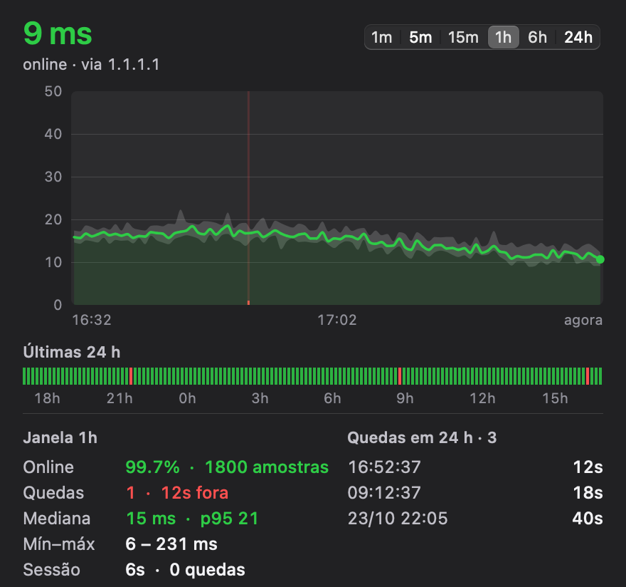
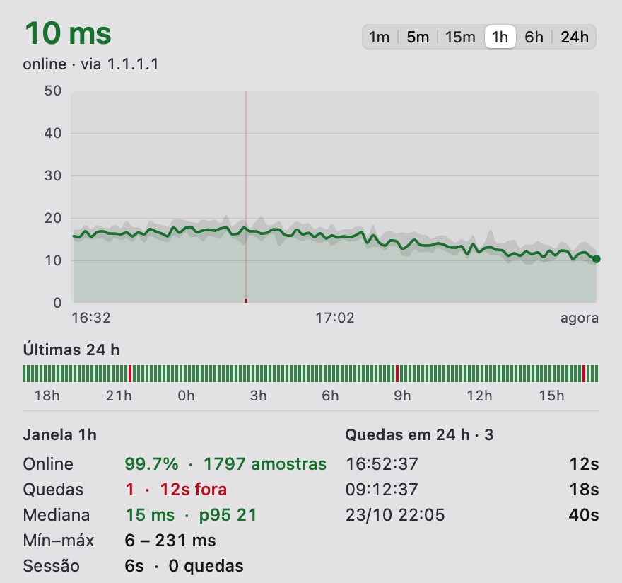
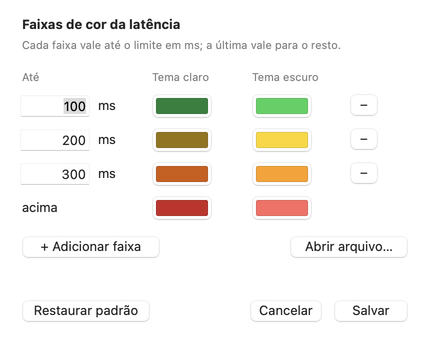

# Netwatch

A tiny macOS menu bar app that shows whether your internet is working right
now, and keeps a record of every time it dropped.

<p align="center">
  
  
</p>

## What it does

- **Menu bar:** a colored dot and the current latency (for example `● 14 ms`).
  Green, yellow, orange and red by default; you choose the limits and colors.
- **Click it** for a panel with:
  - a latency chart (1 min to 24 h);
  - a strip of the last 24 hours;
  - uptime, outages, median and p95 latency;
  - the most recent outages.
- **Keeps a log** of every test and every outage in `~/.netwatch`, so you can
  see (or prove) exactly when and for how long your connection was down.
- **Works where ping doesn't.** It tests with a TCP connection to port 443
  instead of ICMP, so it works on networks that block ping, like many mobile
  carriers.
- **Counts an outage only when everything fails.** If 1.1.1.1 doesn't answer,
  it tries 8.8.8.8 and 9.9.9.9 before reporting one.
- **Knows when the Mac is asleep.** It pauses during sleep (including the
  short maintenance wakes with the lid closed), so sleep never shows up as an
  outage.

## Built for low memory and battery use

It's meant to run all day without you noticing. Measured on a MacBook with
Apple silicon (macOS 15), menu closed, over 20-minute runs:

| | |
|---|---|
| Memory (physical footprint) | **~12 MB**, with 24 h of history loaded |
| Energy Impact (Activity Monitor) | **0.0** |
| CPU | **~0.04 %** (about half a second of CPU every 20 minutes) |
| Wakeups | **~0.15 per second** |
| App size | 560 KB (universal binary) |

How it gets there:

- **One small test every 2 seconds.** It does a single TCP handshake to a
  single server and closes it with a reset, so there's no FIN exchange and no
  socket left in TIME_WAIT. The backup servers are only tried when the first
  one fails.
- **No threads waiting around.** A system timer with 10 % leeway lets macOS
  group the wakeup with other work. The test runs at "utility" priority, so it
  can stay on the efficiency cores.
- **Wakes the interface only when needed.** The menu bar text changes right
  away if the color changes. Otherwise it changes at most every 30 s, and only
  if the number moved at least 10 ms and 15 %. The panel is drawn only while
  the menu is open.
- **Compact history.** 8 bytes per sample. Samples go to disk in batches every
  30 s; outages are written immediately.
- **Native and dependency-free.** Plain AppKit, drawn by hand: no WebView, no
  Electron, no third-party libraries.
- **Careful with the color picker.** It opens on the RGB sliders, because
  showing the color wheel alone pushes the app to about 70 MB.

Opening the menu can briefly use more memory, because macOS sets up graphics
buffers for it: up to about 90 MB for a moment in dark mode. It settles back
to roughly 15–23 MB.

## Install

Requires macOS 14 or later (Apple silicon or Intel).

### With Homebrew

```sh
brew install --cask seupedro/tap/netwatch
```

The cask removes the quarantine flag, so it opens without the Gatekeeper
warning. To start it at login: **System Settings → General → Login Items**.
`brew uninstall --cask netwatch` removes it (`--zap` also deletes the data in
`~/.netwatch`).

### Manually

1. Download `Netwatch-1.0.0.zip` from
   [Releases](https://github.com/seupedro/netwatch/releases), unzip it and move
   `Netwatch.app` to `/Applications`.
2. The app isn't notarized by Apple. The first time you open it, macOS will
   block it: go to **System Settings → Privacy & Security** and click
   **Open Anyway**. Or run:
   ```sh
   xattr -dr com.apple.quarantine /Applications/Netwatch.app
   ```
3. To start it at login: **System Settings → General → Login Items** and add
   Netwatch.

### From source

Needs the Xcode Command Line Tools (`xcode-select --install`).

```sh
git clone https://github.com/seupedro/netwatch
cd netwatch
scripts/instalar.sh   # builds, installs to /Applications and starts at login
```

`scripts/instalar.sh --remover` uninstalls it. The app and its LaunchAgent go
to the Trash; your data stays in `~/.netwatch`.

## Settings

Open the menu → **Configurações…** (⌘,), or edit `~/.netwatch/config.toml`.
You can have as many color bands as you want:

<p align="center"></p>

```toml
faixas = [
  { ate_ms = 100, cor = "#168038", cor_escuro = "#30d158" },  # up to 100 ms: green
  { ate_ms = 200, cor = "#967300", cor_escuro = "#ffd60a" },  # up to 200 ms: yellow
  { ate_ms = 300, cor = "#d25a00", cor_escuro = "#ff9f0a" },  # up to 300 ms: orange
  { cor = "#c82424", cor_escuro = "#ff6961" },                # above: red
]
```

`cor` is used in light mode and `cor_escuro` in dark mode.

## Files

| File | Contents |
|---|---|
| `~/.netwatch/samples.csv` | One line per test: time, epoch, latency in ms (empty = no answer), server |
| `~/.netwatch/events.log` | `CAIU` (went down), `VOLTOU` (came back), `PAUSA` (no measurements, e.g. sleep) |
| `~/.netwatch/config.toml` | Color bands |
| `~/Library/Logs/Netwatch.log` | App log (when started by the LaunchAgent) |

The interface is in Brazilian Portuguese ("Sem conexão" = no connection,
"Quedas" = outages).

## Development

```sh
scripts/compilar.sh   # build/Netwatch.app (universal)
scripts/testar.sh     # tests
```

For testing without touching your real data, run the binary with
`NETWATCH_DIR=/some/folder`. Add `NETWATCH_PNG=panel.png` to save the panel as
an image and quit; `NETWATCH_JANELA=0-5` picks the time window and
`NETWATCH_TEMA=claro|escuro` the theme.

## License

[MIT](LICENSE)
