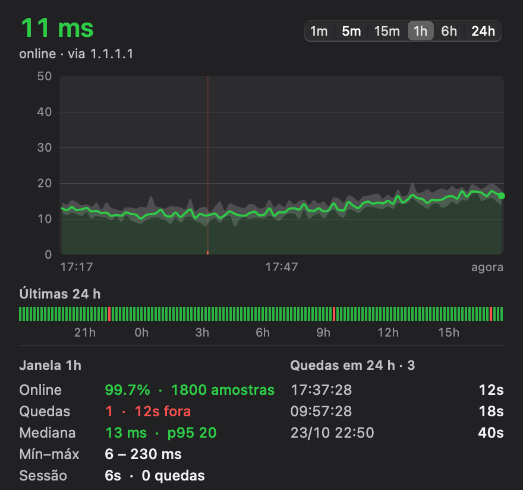
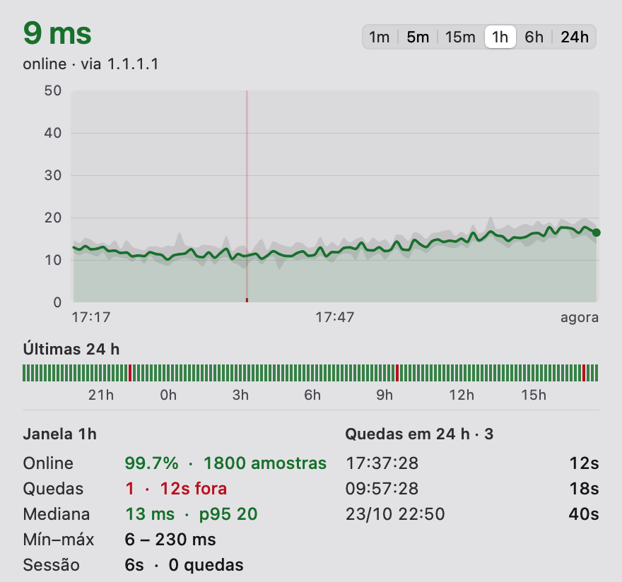
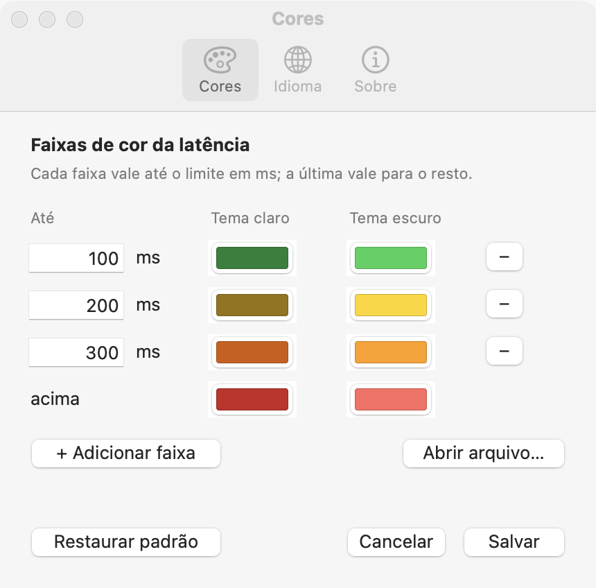
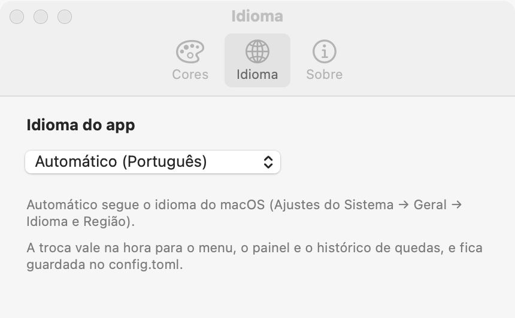
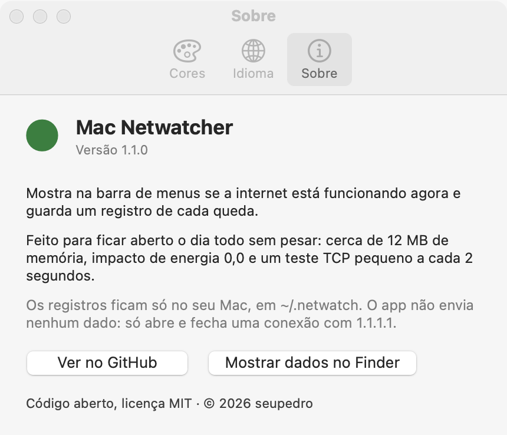

# Mac Netwatcher

[English](README.md) · **Português**

Um app pequeno para a barra de menus do macOS que mostra se a sua internet
está funcionando agora e guarda um registro de cada vez que ela caiu.

<p align="center">
  
  
</p>

## O que ele faz

- **Barra de menus:** uma bolinha colorida e a latência atual (por exemplo
  `● 14 ms`). Verde, amarelo, laranja e vermelho por padrão; você escolhe os
  limites e as cores.
- **Clique nela** para abrir um painel com:
  - um gráfico da latência (de 1 min a 24 h);
  - uma faixa com as últimas 24 horas;
  - tempo online, quedas, mediana e p95 da latência;
  - as quedas mais recentes.
- **Guarda um registro** de cada teste e de cada queda em `~/.netwatch`, para
  você ver (ou provar) exatamente quando e por quanto tempo a conexão caiu.
- **Funciona onde o ping não funciona.** Testa com uma conexão TCP na porta
  443 em vez de ICMP, então funciona em redes que bloqueiam ping, como muitas
  operadoras móveis.
- **Só conta queda quando tudo falha.** Se 1.1.1.1 não responde, ele tenta
  8.8.8.8 e 9.9.9.9 antes de registrar uma.
- **Sabe quando o Mac está dormindo.** Pausa durante o sono (inclusive nos
  despertares rápidos de manutenção com a tampa fechada), então o sono nunca
  aparece como queda.
- **Em português e inglês.** Segue o idioma do macOS, ou você escolhe um nas
  configurações.

## Feito para gastar pouca memória e bateria

A ideia é ficar aberto o dia todo sem você perceber. Medido num MacBook com
Apple Silicon (macOS 15), com o menu fechado, em rodadas de 20 minutos:

| | |
|---|---|
| Memória (physical footprint) | **~12 MB**, com 24 h de histórico carregadas |
| Impacto de energia (Monitor de Atividade) | **0,0** |
| CPU | **~0,04 %** (cerca de meio segundo de CPU a cada 20 minutos) |
| Despertares | **~0,15 por segundo** |
| Tamanho do app | 650 KB (binário universal) |

Como ele chega lá:

- **Um teste pequeno a cada 2 segundos.** Faz um único handshake TCP com um
  único servidor e fecha com reset, então não tem troca de FIN nem socket
  parado em TIME_WAIT. Os servidores de reserva só são testados quando o
  primeiro falha.
- **Nenhuma thread parada esperando.** Um timer do sistema com 10 % de folga
  deixa o macOS agrupar o despertar com outros trabalhos. O teste roda com
  prioridade "utility", então pode ficar nos núcleos de eficiência.
- **Só acorda a interface quando precisa.** O texto da barra muda na hora se
  a cor mudar. Fora isso, muda no máximo a cada 30 s, e só se o número andou
  pelo menos 10 ms e 15 %. O painel só é desenhado com o menu aberto.
- **Histórico compacto.** 8 bytes por amostra. As amostras vão para o disco
  em lotes a cada 30 s; as quedas são gravadas na hora.
- **Nativo e sem dependências.** AppKit puro, desenhado à mão: sem WebView,
  sem Electron, sem bibliotecas de terceiros. As traduções são textos no
  próprio código, sem pacotes de localização para carregar.
- **Cuidado com o seletor de cores.** Ele abre nos controles RGB, porque só
  mostrar a roda de cores leva o app a uns 70 MB. A janela de configurações é
  liberada assim que você a fecha.

Abrir o menu pode usar mais memória por um instante, porque o macOS prepara
buffers gráficos para ele: até uns 90 MB por um momento no tema escuro.
Depois volta para algo entre 15 e 23 MB.

## Instalação

Precisa do macOS 14 ou mais novo (Apple Silicon ou Intel).

### Pelo Homebrew

```sh
brew install --cask seupedro/tap/mac-netwatcher
```

O cask tira a marca de quarentena, então o app abre sem o aviso do
Gatekeeper. Para abrir no login: **Ajustes do Sistema → Geral → Itens de
Início**. `brew uninstall --cask mac-netwatcher` remove o app (`--zap` também
apaga os dados em `~/.netwatch`).

### Manualmente

1. Baixe o `mac-netwatcher-1.1.0.zip` em
   [Releases](https://github.com/seupedro/mac-netwatcher/releases),
   descompacte e mova o `Mac Netwatcher.app` para `/Applications`.
2. O app não é notarizado pela Apple. Na primeira vez que você abrir, o
   macOS vai bloquear: vá em **Ajustes do Sistema → Privacidade e Segurança**
   e clique em **Abrir Mesmo Assim**. Ou rode:
   ```sh
   xattr -dr com.apple.quarantine "/Applications/Mac Netwatcher.app"
   ```
3. Para abrir no login: **Ajustes do Sistema → Geral → Itens de Início** e
   adicione o Mac Netwatcher.

### Pelo código-fonte

Precisa das Command Line Tools do Xcode (`xcode-select --install`).

```sh
git clone https://github.com/seupedro/mac-netwatcher
cd mac-netwatcher
scripts/instalar.sh   # compila, instala em /Applications e abre no login
```

`scripts/instalar.sh --remover` desinstala. O app e o LaunchAgent vão para a
Lixeira; seus dados ficam em `~/.netwatch`.

## Configurações

Abra o menu → **Configurações…** (⌘,). A janela tem três abas.

**Cores:** as faixas de cor da latência. Pode ter quantas quiser.

<p align="center"></p>

**Idioma:** português, inglês ou Automático (segue o idioma do macOS). Vale
na hora, sem reiniciar.

<p align="center"></p>

**Sobre:** versão, licença e o link para esta página.

<p align="center"></p>

Tudo fica salvo em `~/.netwatch/config.toml`, que também dá para editar à mão
(depois abra o menu de novo para aplicar):

```toml
idioma = "pt"  # "pt" ou "en"; sem a linha, segue o macOS

faixas = [
  { ate_ms = 100, cor = "#168038", cor_escuro = "#30d158" },  # até 100 ms: verde
  { ate_ms = 200, cor = "#967300", cor_escuro = "#ffd60a" },  # até 200 ms: amarelo
  { ate_ms = 300, cor = "#d25a00", cor_escuro = "#ff9f0a" },  # até 300 ms: laranja
  { cor = "#c82424", cor_escuro = "#ff6961" },                # acima: vermelho
]
```

`cor` vale no tema claro e `cor_escuro` no tema escuro.

## Arquivos

| Arquivo | Conteúdo |
|---|---|
| `~/.netwatch/samples.csv` | Uma linha por teste: horário, epoch, latência em ms (vazio = sem resposta), servidor |
| `~/.netwatch/events.log` | `CAIU`, `VOLTOU`, `PAUSA` (sem medição, por exemplo com o Mac dormindo), `INICIO` e `FIM` (`DOWN`, `UP`, `PAUSE`, `START`, `END` em inglês) |
| `~/.netwatch/config.toml` | Idioma e faixas de cor |
| `~/Library/Logs/Netwatch.log` | Log do app (quando aberto pelo LaunchAgent) |

## Desenvolvimento

```sh
scripts/compilar.sh   # "build/Mac Netwatcher.app" (universal)
scripts/testar.sh     # testes
scripts/capturas.sh   # as imagens de docs/, com dados inventados
```

Para testar sem mexer nos seus dados de verdade, rode o binário com
`NETWATCH_DIR=/alguma/pasta`. Com `NETWATCH_PNG=painel.png`, ele salva o
painel como imagem e sai; `NETWATCH_JANELA=0-5` escolhe a janela de tempo,
`NETWATCH_TEMA=claro|escuro` o tema e `NETWATCH_IDIOMA=pt|en` o idioma.

## Licença

[MIT](LICENSE)
